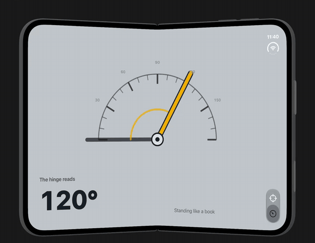

# Hinge Guess

Fold the phone to the angle on screen, tap **Measure**, and see how close you got. The hinge is the
controller.



[Full-quality video](docs/demo.mp4)

Built with [Angular Native](https://ng-native.com): Angular components rendering real native iOS
views through React Native's Fabric renderer. No WebView, and React is never in the render path.

## What's in it

- **Game:** a random target angle, scored on how close your fold lands, with a running average.
- **Meter:** the live hinge angle and the posture (standing like a book, or lying flat).
- **Unfold prompt:** while the phone is closed, an animation shows you to open it.
- A native iOS tab bar, hidden while the phone is closed.

The dial's face is a static SVG drawn with `<ng-icon [svg]>`. The needle is a native view rotated
from a signal and eased with `requestAnimationFrame`. Both tabs share one needle position, so
switching tabs sweeps on from where the other dial was.

## How the hinge gets to Angular

`modules/foldable` is a local Expo module. On iOS it reads `UIHinge`, `UIHingeInteraction` and the
window's reserved regions, and sends `onFoldStateChange` and `onHingeAngleChange` events. The Swift
fold detection comes from [capacitor-foldable](https://github.com/erkamyaman/capacitor-foldable).

`src/foldable/foldable.ts` turns those events into signals (`angle`, `fold`, `open`, `crease`) that
the rest of the app reads. The Android side is a stub for now.

## Running it

It needs an iPhone Duo, which means the **Xcode 27.1 SDK** and its simulator. Expo Go can't load the
local module, so it's a development build.

```sh
npm install
npx expo prebuild --platform ios
npm run ios        # builds and launches on the simulator
```

If Xcode 27.1 isn't your default Xcode, point the build at it first:

```sh
export DEVELOPER_DIR=/path/to/Xcode-27.1.app/Contents/Developer
```

Open the Duo in DeviceHub and fold it with the hinge slider. The simulator has no command for
folding.

```sh
npm test           # the game's scoring, on a fake hinge, with no simulator
npm run typecheck
```

## Layout

```
modules/foldable/   the native hinge module (Swift, plus an Android stub)
src/foldable/       the Foldable service: hinge events as signals
src/instrument/     the shared screen: two pages either side of the crease, the dial on it
src/dial/           the angle dial
src/game/           the game screen and its scoring
src/meter/          the live meter screen
src/app/            the shell, routes and native tabs
```
